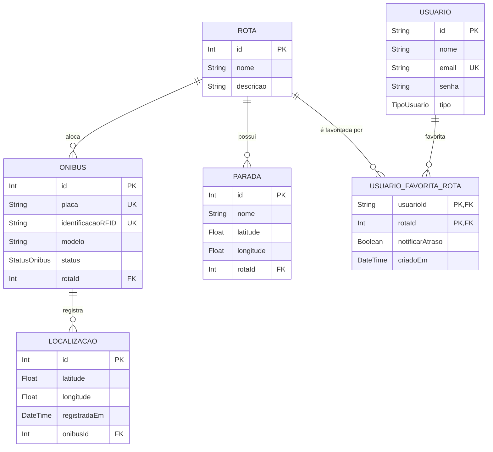

# Modelo de Dados — Seu Ônibus, Sua Rota

Este documento apresenta a evolução do modelo de dados do projeto, justificando as decisões de negócio e o mapeamento relacional (Etapa 3 - Bloco A).

## 1. Diagrama ER Atualizado

## 2. Antes × Depois: Evolução do Modelo

| Entidade / Campo | Como era (Antes) | Como ficou (Depois) | Justificativa de Negócio |
| :--- | :--- | :--- | :--- |
| **Usuario (id)** | `Int` (Autoincrement) | `String` (UUID) | Como o ID do usuário trafega em rotas da API, o UUID impede que pessoas externas descubram a quantidade exata de usuários cadastrados no sistema. |
| **Onibus (status)** | `String` (Texto livre) | `Enum StatusOnibus` | Protege a integridade dos dados, impedindo que erros de digitação entrem no banco. Garante que só existam os status `ATIVO`, `INATIVO` e `MANUTENCAO`. |
| **Usuario (tipo)** | `String` (Texto livre) | `Enum TipoUsuario` | Padroniza os papéis (`ALUNO`, `RESPONSAVEL`, `ADMIN`) para facilitar a matriz de permissões e autorização na API. |
| **UsuarioFavoritaRota** | Não existia | Entidade Associativa | Cria a relação N-N exigida entre Usuário e Rota com dados próprios (`notificarAtraso`, `criadoEm`), sustentando a história Must de alertas personalizados. |

## 3. Chaves Estrangeiras e Regras de Deleção

| Relação (Origem → Destino) | Regra (`onDelete`) | Justificativa de Negócio |
| :--- | :--- | :--- |
| **Onibus → Rota** | `SET NULL` | A exclusão de uma rota gerencial não destrói o ônibus físico. O veículo apenas perde sua alocação atual e fica aguardando atribuição a uma nova rota. |
| **Parada → Rota** | `SET NULL` | Se a rota de transporte for extinta, a estrutura física da parada (o abrigo) continua existindo na rua e pode ser reaproveitada por rotas futuras. |
| **Localizacao → Onibus** | `CASCADE` | A localização é um dado efêmero gerado pelo veículo. Se o ônibus for completamente excluído da frota/sistema, o histórico de rastreamento dele perde o sentido e deve ser expurgado. |
| **UsuarioFavoritaRota → Usuario** | `CASCADE` | Se um usuário excluir sua conta do sistema, não há motivo para reter no banco as suas preferências de alerta de rotas. |
| **UsuarioFavoritaRota → Rota** | `CASCADE` | Se uma rota deixar de existir definitivamente, os favoritamentos e alertas pendentes configurados para ela perdem a utilidade. |

## 4. Restrições e Proteções do Banco

*   **`@unique` em `Onibus.placa`:** Regra de negócio que impede o cadastro duplicado do mesmo veículo físico.
*   **`@unique` em `Onibus.identificacaoRFID`:** Impede a clonagem de tags de monitoramento, garantindo que cada sensor físico aponte para apenas um ônibus no painel.
*   **`@unique` em `Usuario.email`:** Garante a unicidade de acesso, evitando duas contas conflitantes para o mesmo contato.
*   **Índice Composto (`@@id([usuarioId, rotaId])`) em `UsuarioFavoritaRota`:** Atua como Chave Primária e protege o sistema impedindo que o mesmo usuário favorite a mesma rota duas vezes, evitando lixo na base de dados.
*   **Índice de Performance (`@@index([onibusId, registradaEm])`) em `Localizacao`:** Como o volume de ping de GPS será alto, este índice garante performance nas buscas (ex: "última localização do ônibus X").