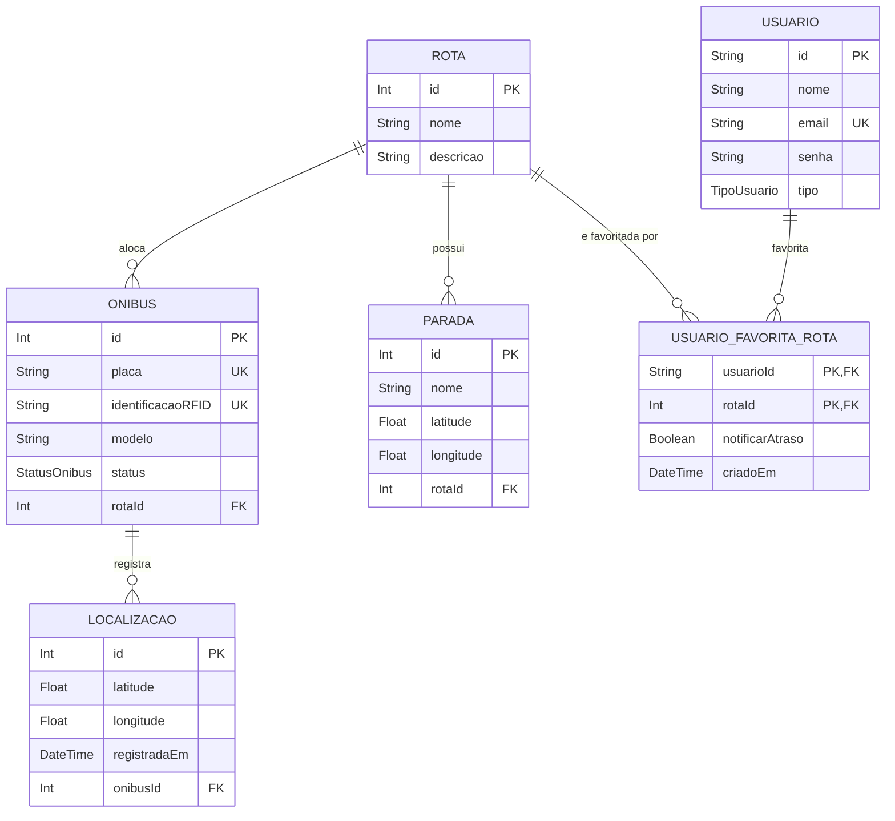

# Modelo de Dados — Seu Ônibus, Sua Rota

Este documento apresenta o modelo de dados do projeto Seu Ônibus, Sua Rota, suas regras de negócio, relacionamentos, restrições e evolução da estrutura relacional.

## 1. Diagrama Entidade-Relacionamento

## 2. Entidades e relacionamentos

- **Rota:** representa uma rota de transporte e pode possuir vários ônibus, paradas e usuários que a favoritam.
- **Onibus:** representa um veículo, identificado por placa e identificação RFID únicas. Pode estar associado a uma rota.
- **Parada:** representa um ponto de embarque ou desembarque, com nome e coordenadas geográficas. Pode estar associada a uma rota.
- **Localizacao:** armazena as coordenadas e a data de registro de cada localização de um ônibus.
- **Usuario:** representa os usuários do sistema, identificados por UUID, com nome, e-mail, senha e tipo de usuário.
- **UsuarioFavoritaRota:** entidade associativa que implementa o relacionamento muitos-para-muitos entre usuários e rotas, permitindo armazenar preferências de notificação e data de criação.

## 3. Evolução do modelo de dados

| Entidade / Campo | Modelo anterior | Modelo atual | Justificativa |
|---|---|---|---|
| Usuario.id | Inteiro autoincremental |